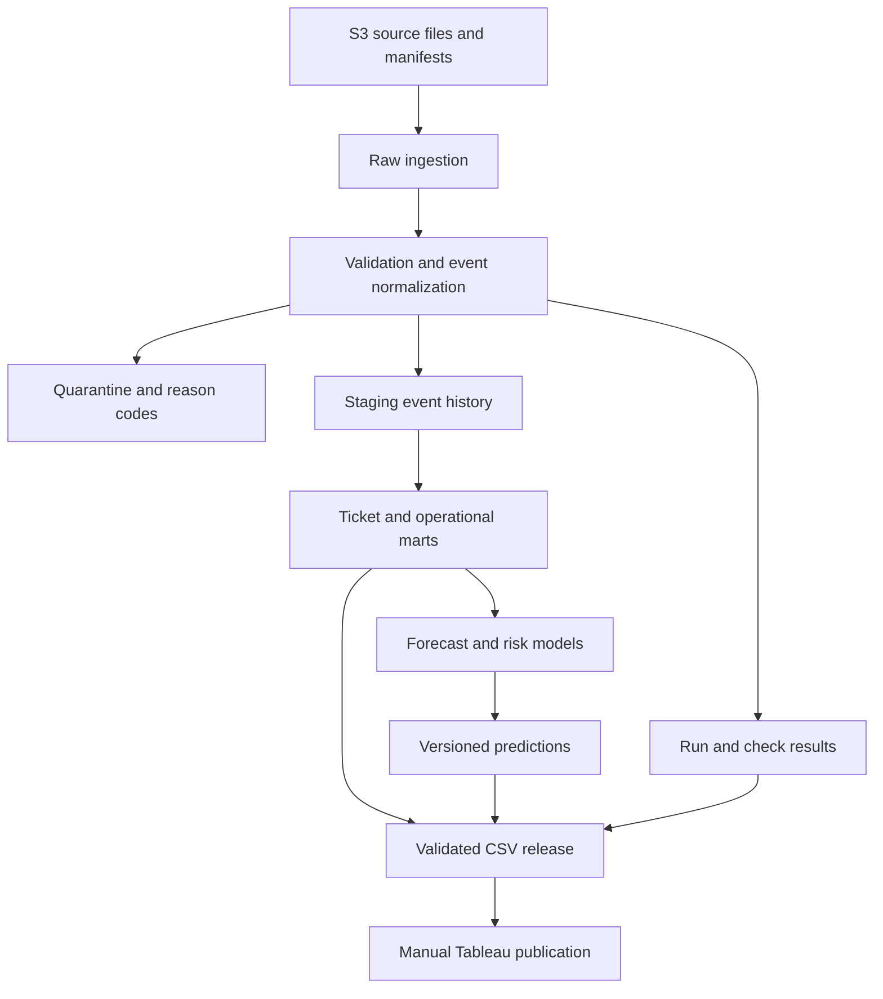

# IT Service Desk Intelligence — Detailed Implementation Plan

**Purpose:** Build a reproducible IT operations analytics project for the SJSU Data Analytics Graduate Intern application.

**Planning date:** November 18, 2026. **Format:** Implementation logic, decisions, deliverables, and acceptance gates; no application code, SQL statements, configuration snippets, or shell commands.

**Project boundary:** This plan covers the IT Service Desk Intelligence resume project. Campus Website Content Analytics is a separate project and is outside this build.

## Contents

1. Project outcome and scope
2. Dataset and technology links
3. Architecture and data contracts
4. Phase 0 — Feasibility and source verification
5. Phase 1 — Project foundation and reproducibility
6. Phase 2 — Synthetic fixtures and historical replay
7. Phase 3 — Raw ingestion and batch tracking
8. Phase 4 — Validation, quarantine, and quality reporting
9. Phase 5 — Ticket marts and operational metrics
10. Phase 6 — Exploratory analysis and decision questions
11. Phase 7 — Ticket-volume forecasting
12. Phase 8 — SLA-risk modeling and leakage audit
13. Phase 9 — Prediction storage and publication exports
14. Phase 10 — Scheduling, recovery, and continuous integration
15. Phase 11 — Tableau dashboard and staff experience
16. Phase 12 — AWS deployment and operations
17. Phase 13 — Documentation, demonstration, and resume evidence
18. Final acceptance checklist and scope reduction

## 1. Project outcome and scope

### 1.1 What the project should answer

- How many distinct tickets arrive, and when does workload increase?
- Which ticket categories and priorities have longer observed resolution times?
- Where do reopens and reassignments coincide with delays?
- How much observed backlog exists at each historical cutoff?
- Can a forecast improve on a same-weekday-last-week baseline?
- Can opening-time information identify tickets likely to have an adverse SLA outcome?
- How fresh and trustworthy are the data and model outputs?

The intended audience is a nontechnical IT service manager. Findings should support review and planning; they should not automatically assign blame, change staffing, or escalate individual tickets.

### 1.2 Required portfolio deliverables

| Deliverable | Required evidence |
| --- | --- |
| Scheduled Python/SQL pipeline | Repeatable ingestion, event preservation, validation, quarantine, and reliable reruns |
| PostgreSQL analytical layer | Distinct ticket facts, historical states, daily arrivals, resolution statistics, and quality summaries |
| Forecasting experiment | Explicit forecast horizon, chronological evaluation, baseline comparison, and limitations |
| SLA-risk experiment | Verified outcome definition, opening-time feature contract, temporal validation, and threshold policy |
| Tableau Public workbook | Three dashboard pages using versioned CSV exports, with visible source and freshness labels |
| AWS deployment | Working containerized pipeline, private storage, instance-role authentication, and recovery evidence |
| Documentation | Data dictionary, pipeline guide, staff guide, model cards, and an insights memo |
| Evidence ledger | Measured results traceable to an immutable input snapshot, model version, and evaluation run |

Successful completion does not require beating every baseline. A baseline may remain the selected model if more complex models do not improve evaluation results.

### 1.3 Keep the implementation focused

Use one Python application and PostgreSQL with plain SQL transformations. Add dbt only after the SQL pipeline works. Use XGBoost as a challenger after simpler baselines exist. Training may run locally; the deployed pipeline can load approved model artifacts and perform inference.

Do not make a custom React frontend, a chatbot, embeddings, Kubernetes, or streaming infrastructure part of this project. The public source does not provide ticket-description text; it cannot support a genuine text-clustering feature without a separately sourced dataset. The resume already has other projects demonstrating frontend and REST API development.

## 2. Dataset and technology links

### 2.1 Primary dataset and attribution

| Resource | Link | Use |
| --- | --- | --- |
| UCI dataset page | [Incident management process enriched event log](https://archive.ics.uci.edu/dataset/498/incident+management+process+enriched+event+log) | Authoritative source description, schema, download, and citation |
| Download archive | [UCI ZIP download](https://archive.ics.uci.edu/static/public/498/incident+management+process+enriched+event+log.zip) | Obtain the original CSV; record checksum and retrieval date |
| Authors' field documentation | [Attribute-description PDF](https://each.uspnet.usp.br/sarajane/wp-content/uploads/2018/09/Incidents_event_log_description.pdf) | Source semantics and collection context; the PDF may require retrying if the host times out |
| Alternate author-hosted documentation | [Attribute-description PDF mirror](https://processmining.each.webhostusp.sti.usp.br/wp-content/uploads/2021/02/Incidents_event_log_description.pdf) | Fallback reference for the same documentation |
| Dataset DOI | [10.24432/C57S4H](https://doi.org/10.24432/C57S4H) | Stable attribution in README and model cards |
| License | [Creative Commons Attribution 4.0](https://creativecommons.org/licenses/by/4.0/) | Include attribution and identify modifications |

The repository describes an anonymized ServiceNow audit export with 141,712 events, 24,918 incidents, and 36 attributes. It explicitly notes that repeated rows can occur because not all underlying process attributes are included. It also excludes textual ticket fields. Treat these as expected source characteristics, not automatic reasons to discard incidents.

The authors describe collection from March 2016 to February 2017. That collection window is not proof of twelve complete months of ticket arrivals. The downloaded CSV was inspected while preparing this plan; its actual opening-date distribution confirms that distinction.

### 2.2 Preliminary inspection of the downloaded CSV

This is a source inspection, not a completed pipeline, a model evaluation, or proof of source completeness. Reproduce it in the project and preserve the findings as an input profile.

| Observation | Measured result | Implementation consequence |
| --- | --- | --- |
| Event rows / distinct incidents | 141,712 / 24,918 | Separate event-level and incident-level counts |
| Opening timestamps | February 29, 2016 01:16 through February 16, 2017 14:17 | Broad span alone does not establish useful arrival history |
| Update timestamps | February 29, 2016 01:23 through February 18, 2017 15:00 | Do not forecast new tickets from update-event counts |
| March–May 2016 arrivals | 24,437 incidents, approximately 98.1% of all incidents | Treat later months as a severe coverage/regime warning, not routine low demand |
| Earliest row already contains closed_at | All 24,918 incidents | Exclude enriched outcome timestamps from point-in-time inputs |
| Earliest row already contains resolved_at | 23,362 incidents | Even an early event row can contain future outcome information |
| Incidents whose made_sla changes over their history | 9,114 | Do not use the first row's flag as the final target |
| Latest-observed made_sla counts | true: 15,803; false: 9,115 | Incident-level balance differs greatly from event-row balance; polarity remains a separate semantic question |
| Earliest observed states | 16,397 New; 6,503 Active; 1,819 Resolved; 199 awaiting states | Not every incident begins with a creation snapshot |
| First-observation delay relative to opening | Median 1 minute; minimum −147 minutes; maximum 1,146 minutes | Investigate negative delays and define eligible prediction snapshots explicitly |
| CSV temporal format parsed | Day/month/year, hour:minute | Use an explicit parser and separately record timezone uncertainty |
| Actual closure-code column | closed_code | The website prose uses close_code; use the downloaded header as the physical schema |

| Opening month | Distinct incidents |
| --- | ---: |
| February 2016 | 207 |
| March 2016 | 8,995 |
| April 2016 | 7,934 |
| May 2016 | 7,508 |
| June 2016 | 5 |
| July 2016 | 14 |
| August 2016 | 15 |
| September 2016 | 12 |
| October 2016 | 16 |
| November 2016 | 26 |
| December 2016 | 37 |
| January 2017 | 94 |
| February 2017 | 55 |

**Recommended forecast decision:** Do not train a full-year real-demand model on this series by default. Start with a clearly labeled synthetic campus forecasting track. A restricted March–May historical forecast can be an additional feasibility experiment if its completeness is defensible; the short window still limits evaluation. This does not prevent using the real incident data for descriptive analytics and a carefully qualified SLA experiment.

Snapshot identifiers: ZIP SHA-256 is `6294e29a311647306bfdfc85783f7df66517c197b9cd49aa5ee36ba9c525d1d6`; CSV SHA-256 is `fd184bbfd62329cfe093e99da2ea7071905f2ead91900b448eb2635870821bef`. CSV size: 46,212,397 bytes. These are integrity references for the inspected download, not requirements that a future upstream release must have the same bytes.

### 2.3 Core application and analytics stack

| Technology | Official link | Purpose and selection |
| --- | --- | --- |
| Python | [Python documentation](https://docs.python.org/3/) | Pipeline, validation, synthetic fixtures, models, and exports; choose a supported version compatible with the complete dependency set |
| pandas | [pandas documentation](https://pandas.pydata.org/docs/) | CSV parsing, profiling, feature preparation, and export shaping |
| NumPy | [NumPy documentation](https://numpy.org/doc/) | Reproducible random generation and numerical operations |
| SQL / PostgreSQL | [PostgreSQL documentation](https://www.postgresql.org/docs/current/) | Persistent raw, staging, marts, model results, and operational metadata |
| Psycopg | [Psycopg 3 documentation](https://www.psycopg.org/psycopg3/docs/) | Python-to-PostgreSQL access and transaction control |
| scikit-learn | [User guide](https://scikit-learn.org/stable/user_guide.html) | Preprocessing pipelines, logistic regression, dummy baselines, and evaluation |
| statsmodels | [Time-series documentation](https://www.statsmodels.org/stable/tsa.html) | Weekly seasonal ETS or SARIMAX forecasting |
| XGBoost | [XGBoost documentation](https://xgboost.readthedocs.io/en/stable/) | Optional stronger challenger for forecast regression and SLA classification |
| Matplotlib | [Matplotlib documentation](https://matplotlib.org/stable/) | Reproducible EDA and evaluation figures for documentation |
| Joblib | [Joblib documentation](https://joblib.readthedocs.io/en/stable/) | Persist trusted scikit-learn preprocessing/model artifacts with environment metadata |
| pytest | [pytest documentation](https://docs.pytest.org/en/stable/) | Unit, database integration, leakage, and end-to-end tests |
| Ruff | [Ruff documentation](https://docs.astral.sh/ruff/) | Consistent linting and formatting in local development and CI |
| Git | [Git documentation](https://git-scm.com/doc) | Version control for implementation, contracts, and documentation |
| GitHub Actions | [Actions documentation](https://docs.github.com/en/actions) | CI, reproducibility checks, and optional manual pipeline trigger |
| Docker Engine | [Docker documentation](https://docs.docker.com/engine/) | Package the pipeline runtime |
| Docker Compose | [Compose documentation](https://docs.docker.com/compose/) | Run PostgreSQL, pipeline, and scheduler with persistent volumes |
| Supercronic | [Official repository](https://github.com/aptible/supercronic) | Run the scheduled container job; select one scheduler as primary |
| Tableau Public | [Public FAQ](https://help.tableau.com/current/pro/desktop/en-us/public_faq.htm) | Public portfolio dashboard built from curated CSV extracts |

Pin compatible released package versions and container image versions after a clean installation and smoke test. Do not copy a documentation site's development version into the project automatically. Record the exact environment alongside model artifacts.

### 2.4 AWS stack

| Technology | Official link | Purpose |
| --- | --- | --- |
| Amazon EC2 | [EC2 guide](https://docs.aws.amazon.com/AWSEC2/latest/UserGuide/concepts.html) | Host the Compose stack after local verification |
| Ubuntu Server | [Server documentation](https://ubuntu.com/server/docs/) | Linux host operating system |
| Amazon S3 | [S3 guide](https://docs.aws.amazon.com/AmazonS3/latest/userguide/Welcome.html) | Immutable raw files, manifests, exports, artifacts, and backups |
| Boto3 | [AWS SDK for Python](https://docs.aws.amazon.com/boto3/latest/) | S3 object access and AWS service integration |
| IAM instance role | [IAM roles for EC2](https://docs.aws.amazon.com/IAM/latest/UserGuide/id_roles_use_switch-role-ec2.html) | Temporary credentials scoped to required resources |
| AWS Secrets Manager | [Secrets Manager guide](https://docs.aws.amazon.com/secretsmanager/latest/userguide/intro.html) | Retrieve the database password at runtime |
| Systems Manager Session Manager | [Session Manager guide](https://docs.aws.amazon.com/systems-manager/latest/userguide/session-manager.html) | Administrative access without opening PostgreSQL to the internet |
| AWS Budgets | [Budgets guide](https://docs.aws.amazon.com/cost-management/latest/userguide/budgets-managing-costs.html) | Cost notifications; these do not themselves impose a hard spending cap |
| AWS Pricing Calculator | [Pricing Calculator](https://calculator.aws/) | Estimate regional compute, storage, secrets, logging, and networking costs before deployment |

### 2.5 Optional tools and supporting references

| Resource | Link | Adoption rule |
| --- | --- | --- |
| dbt-postgres | [Postgres adapter setup](https://docs.getdbt.com/docs/core/connect-data-platform/postgres-setup) | Optional replacement for plain SQL orchestration; do not maintain duplicate transformation systems |
| CloudWatch | [CloudWatch guide](https://docs.aws.amazon.com/AmazonCloudWatch/latest/monitoring/WhatIsCloudWatch.html) | Optional central logs and stale-run monitoring after basic operational tables work |
| RDS PostgreSQL | [RDS guide](https://docs.aws.amazon.com/AmazonRDS/latest/UserGuide/Welcome.html) | Deferred managed-database upgrade; not required for the portfolio |
| Terraform | [Terraform documentation](https://developer.hashicorp.com/terraform/docs) | Deferred infrastructure automation after a working deployment exists |
| GitHub-to-AWS OIDC | [OIDC in AWS](https://docs.github.com/en/actions/how-tos/secure-your-work/security-harden-deployments/oidc-in-aws) | Use if Actions needs AWS access; avoid long-lived AWS keys |
| GitHub scheduling | [Workflow scheduling behavior](https://docs.github.com/en/actions/reference/workflows-and-actions/events-that-trigger-workflows#schedule) | Optional fallback; schedules can be delayed and need a deployment/state strategy |
| Tableau edition comparison | [Official feature comparison](https://help.tableau.com/current/pro/desktop/en-us/desktop_comparison.htm) | Verify connectors, live connections, and publishing rights independently |
| Classification metrics | [scikit-learn evaluation guide](https://scikit-learn.org/stable/modules/model_evaluation.html) | Define metrics consistently |
| Average precision | [Average precision definition](https://scikit-learn.org/stable/modules/generated/sklearn.metrics.average_precision_score.html) | Primary ranking metric for the SLA experiment |
| Calibration | [Probability calibration](https://scikit-learn.org/stable/modules/calibration.html) | Assess whether risk scores can be interpreted as probabilities |

### 2.6 Tableau decision

Use the CSV-to-Tableau-Public route as the default. Current Tableau Public documentation says published data uses extracts and does not support live database connections. Its CSV sources do not refresh automatically. Google-connected refresh options exist but are outside this implementation.

The automated pipeline writes export files; the author refreshes and republishes the workbook manually. Document these as two separate operations. Do not assume a student or desktop license automatically provides Tableau Cloud/Server hosting or a public live-PostgreSQL link.

## 3. Architecture and data contracts

### 3.1 Data flow

The scheduler invokes the pipeline; it does not bypass validation. Training and inference are separate activities. Daily inference uses the most recently approved compatible model. Retraining is deliberate, evaluated, and versioned.

### 3.2 Separate data tracks

| Track | Purpose | Permitted claims |
| --- | --- | --- |
| Public historical data | Operational analysis and real-data model evaluation | Findings about this dataset and its observed period |
| Historical replay | Exercise incremental ingestion and as-of prediction using source events | Demonstration of historical processing, not live SJSU operations |
| Synthetic quality fixtures | Prove validation catches known defects | Defect-detection performance on controlled fixtures |
| Synthetic campus scenarios | Simulate calendar-related workload and demonstrate scheduling | Scenario behavior under documented assumptions, not measured campus demand |

Every table, prediction, export, and dashboard view carries a source-track identifier. Synthetic campus scenarios must not enter public-data training, model selection, evaluation, or combined KPIs by accident.

### 3.3 Database objects

| Object | Grain and purpose |
| --- | --- |
| raw.incident_rows | One source row per ingested file and row position; business fields preserved as text |
| ops.ingestion_batches | One processing attempt, with source checksum, object identity, state, counts, and timestamps |
| staging.incident_events | One canonical observed event/snapshot, with parsed fields and provenance |
| quarantine.incident_rows | One rejected raw row, linked to one or more rule violations |
| quarantine.row_violations | One violation per rejected row and rule |
| ops.dq_runs | One batch-level quality summary with status and reconciliation totals |
| ops.dq_check_results | One check result per run, rule, and relevant scope |
| ops.row_quality_issues | One row/rule issue, including nonfatal warnings for accepted rows |
| marts.fact_tickets | One incident per source track; retrospective summary, not an opening-time feature source |
| marts.ticket_open_features | One eligible opening-time feature snapshot per incident |
| marts.ticket_state_history | Observed state intervals used for historical operational views |
| marts.daily_volume | One date per source track within a documented coverage window |
| marts.daily_backlog | One observation date per source track, with completeness flags |
| marts.resolution_stats | One period/category/priority/group combination with counts and duration summaries |
| models.model_registry | One trained model version with dataset, environment, feature contract, and selection status |
| models.evaluation_results | One model/fold/horizon or threshold evaluation record |
| models.forecast_predictions | One model, issue date, target date, and track |
| models.sla_risk_predictions | One incident, feature cutoff, scoring time, and model version |
| ops.export_releases | One validated multi-file release and its publication status |

All objects need creation/update timestamps, a source-track key where applicable, and enough provenance to trace a result to the raw file. Foreign-key relationships should connect batches, quality results, and quarantined rows.

## 4. Phase 0 — Feasibility and source verification

**Dependency:** None. Complete these gates before building models or committing to resume results.

### Tasks

1. Download the archive and record its checksum, file size, retrieval date, source URL, license, delimiter, encoding, and column names.
2. Independently profile minimum/maximum and missingness for opening, creation, update, resolution, and closure timestamps. Confirm the date parsing format explicitly; do not infer day/month order from a small sample.
3. Count unique incidents, events per incident, exact repeated rows, state transitions, and distinct opening dates. Reconcile counts against the source description without forcing them to match a potentially different release.
4. Plot distinct ticket arrivals by date and count incidents opened before the collection window. Inspect the first/last periods for truncation. Missing dates are unknown coverage until evidence supports treating them as zero arrivals.
5. Inspect categorical fields and missing-value markers. Preserve anonymized category and group labels; do not relabel an unknown source category as a genuine campus service.
6. Investigate the SLA field. The source calls it made_sla but its prose describes whether a target was exceeded; do not infer polarity from the name. Inspect documentation, value changes within incidents, final states, and eligibility. Record whether the field is a stable final outcome, an evolving status, or ambiguous.
7. Check opening-time observability. An earliest available audit row may occur after opening and may contain backfilled attributes. Measure first-observation delay and identify which fields can be defended as available at creation.
8. Verify Tableau installation/account access and a minimal CSV-to-public-workbook publication before investing in the full dashboard.

### Gate decisions

| Gate | Proceed condition | Fallback |
| --- | --- | --- |
| Real volume forecasting | A plausibly complete contiguous arrival window supports training and several disjoint seven-day test windows | Keep the real-data descriptive analysis; create a separately labeled synthetic forecasting demonstration |
| Weekly seasonality | Practical starting target: at least 12 complete weeks, preferably 26 or more, with enough folds after lag warm-up | Shorten the claim to a limited feasibility study; do not assert annual or academic-calendar learning |
| SLA classification | Documented flag polarity, stable/mature outcome policy, sufficient positive and negative outcomes, and eligible opening-time snapshots | Retain the raw flag and mark breach modeling blocked; use an explicitly named source-flag prediction or resolution-time experiment only if justified |
| Creation-time inference | Defensible fields and snapshot timing | Restrict features, or move prediction to first observed snapshot and rename the claim everywhere |
| Source coverage | Known scope and boundary assumptions | Mark observed rather than total demand/backlog; avoid unsupported institution-wide interpretations |
| Dashboard publication | Working CSV extract and public URL | Resolve the publication issue before expanding the workbook |

These week-count targets are project design heuristics, not guarantees of statistical adequacy. A short opening-date span cannot be repaired by counting later update events as new arrivals.

### Deliverables

- Dataset feasibility report with actual date ranges, source counts, missingness, coverage decisions, and sample incidents.
- Field-level semantic notes, SLA label decision, and opening-feature allowlist.
- Decision record selecting the real or synthetic forecast track.

**Exit gate:** No unresolved assumption is silently converted into a claimed model target. If a required resume feature is blocked, the plan and eventual resume wording explicitly reflect the fallback.

## 5. Phase 1 — Project foundation and reproducibility

**Dependency:** Phase 0 decisions.

### Tasks

1. Organize the repository into application modules for ingestion, validation, transformations, features, training, scoring, and export. Keep SQL transformations, test fixtures, documentation, dashboard assets, and deployment assets in separate directories.
2. Record runtime and dependency versions. Confirm a clean environment can install all packages and run the database connection smoke test.
3. Define a source-adapter boundary: local files and S3 objects should produce the same internal batch contract.
4. Establish configuration for source track, bucket/prefix, database destination, logical observation time, forecast horizon, training cutoff, and selected model version. Keep credentials outside version control.
5. Define event time, source collection time, ingestion time, and publication time separately. If source timestamps lack a timezone, retain that uncertainty and use a documented analysis convention without claiming the original timezone is known.
6. Create versioned database migrations and an explicit migration runner. Separate schema creation from repeatable data transformations.
7. Define read/write permissions: ingestion writes raw; transformations write staging/marts; scoring writes predictions; the exporter reads approved marts and predictions.
8. Write table contracts covering grain, keys, nullable fields, timestamp interpretation, accepted states, and source provenance.

### Deliverables and exit gate

- Repository structure, dependency lock, configuration reference, and architecture decision record.
- A clean Compose startup with persistent PostgreSQL storage and an explicit readiness check.
- Repeatable schema setup and a connection test that does not expose credentials.

**Exit gate:** A fresh checkout can reproduce the empty local environment without manually creating tables or changing application source.

## 6. Phase 2 — Synthetic fixtures and historical replay

**Dependency:** Data contracts from Phase 1.

### Synthetic quality fixtures

Create deterministic fixture files with a recorded seed and a separate expected-outcome manifest. Include valid incident updates as well as errors so tests prove both detection and non-rejection.

| Fixture | Expected behavior |
| --- | --- |
| Missing incident identifier | Quarantine with a specific reason |
| Missing or unparseable required opening timestamp | Quarantine or exclude the relevant feature row according to the contract |
| Unparseable optional resolution timestamp | Preserve the incident for arrivals; exclude invalid duration metrics and log the violation |
| Resolution before opening | Reject the invalid temporal field/event contribution; preserve unrelated valid incident history |
| Closure before resolution in the same coherent lifecycle | Flag; distinguish genuine inconsistency from reopened-cycle ambiguity |
| Event timestamp after the run's observation cutoff | Defer from historical replay; do not automatically call a later valid event corrupt |
| Repeated incident ID with a later update | Accept as legitimate event history |
| Exact duplicate file under another object name | Skip duplicate effects through checksum tracking |
| Repeated source row | Preserve raw provenance; apply the documented canonicalization policy |
| Conflicting rows with the same proposed event identity | Flag ambiguity; never silently choose a winner |
| New category or unknown optional value | Accept with an unknown category mapping; log drift |
| Missing required column | Reject the batch before downstream publication |

### Campus scenario generator

Generate an independent daily series and synthetic ticket drops with weekday patterns, registration bursts, start-of-term load, finals activity, noise, and optional trend. These are hypotheses chosen for demonstration, not observed SJSU behavior.

Use a versioned scenario calendar with labels and dates. If it references an actual academic calendar, record its source separately; otherwise label it an illustrative calendar. Distinguish synthetic category names from anonymized source codes.

Separate clean scenario generation from defect injection. Keep the clean expected dataset private to tests/evaluation so quality failures can be reconciled exactly. A model trained on one synthetic pattern is not evidence of robustness to every other pattern.

### Historical replay

Partition the original event log by observed update time, with documented fallback for missing update time. Release only events available before the replay clock. Preserve original timestamps and original category codes. Replaying old data should never make it appear to be current campus operations.

**Exit gate:** Repeating a seed reproduces the same fixture; new incident updates are accepted; source tracks cannot be combined without an explicit operation.

## 7. Phase 3 — Raw ingestion and batch tracking

**Dependency:** Phases 1–2.

### Processing logic

1. Discover files from the chosen adapter and compare content checksums with successful historical batches. Object names alone are not a sufficient identity check.
2. Create a batch attempt with source-track ID, object path/version if available, checksum, logical cutoff, and start time.
3. Check the file contract, then load raw business fields as text. Add batch ID, file row number, loaded-at timestamp, and a content fingerprint.
4. Retain the original file unchanged. A raw row is evidence even if a later stage rejects it.
5. Commit the raw load consistently and mark its stage. Resume subsequent stages without duplicating a completed raw load after a crash.
6. Distinguish discovered, loading, loaded, validating, transformed, exported, failed, and skipped/no-new-data outcomes.
7. Preserve failed attempts and error summaries, while separating retry attempts from the logical input identity.

### Idempotency policy

- Delivery may occur more than once; successful data effects must not.
- A duplicate file must not add tickets or events again.
- A later event for an existing ticket must still update downstream summaries.
- Late-arriving valid events trigger recomputation for affected incidents and dates.
- Do not reject every ticket ID already present in history. That would delete the event-log information needed for lifecycle analysis.
- If identical observed rows are collapsed in staging, retain raw copies and a collapse count. The source may contain genuine events indistinguishable in its available columns, so do not claim recovered event counts are exact.

### Tests and exit gate

Test a new file, same-file retry, renamed duplicate, interrupted load, late event, schema mismatch, and an empty input prefix.

**Exit gate:** Two successful runs on unchanged input produce the same canonical event and ticket counts. Legitimate updates still change the correct ticket summaries.

## 8. Phase 4 — Validation, quarantine, and quality reporting

**Dependency:** Raw ingestion.

### Rule design

| Rule family | Examples | Default action |
| --- | --- | --- |
| Batch contract | Missing required columns, unreadable encoding, structurally malformed file | Fail the batch and retain the last good export |
| Identity | Missing incident key, ambiguous event identity | Quarantine the affected row or flag the ambiguity |
| Parsing | Required date cannot parse, invalid required boolean | Quarantine or exclude the affected analytical contribution |
| Temporal consistency | Resolution before opening, impossible lifecycle ordering | Flag with lifecycle context; reject only the invalid contribution |
| Optional completeness | Missing assigned group or category | Accept with an explicit unknown bucket and report missingness |
| Coverage/freshness | Missing expected drop, outdated upstream cutoff | Mark freshness degraded; do not invent zero arrivals |
| Duplicate effects | Reprocessed file or deterministic event replay | Skip duplicate effects and record counts |
| Cross-table integrity | Prediction references absent ticket; incident facts are not unique | Block downstream release |

Rules need a stable ID, severity, applicable fields, explanation, owner/action, and version. Source missing-value markers become nulls only under explicit field rules. Do not quarantine an open ticket simply because it has no resolution time.

### Operational tables

Keep ops.dq_runs at one row per batch summary. Store individual check results in ops.dq_check_results rather than adding a new column every time a rule changes. Record checked rows, failures, distinct affected rows, status, threshold, rule version, and a link to the batch.

Assign each raw row one primary disposition: accepted, accepted with warnings, quarantined for a fatal error, or excluded from canonical staging as a duplicate. Quarantine is reserved for fatal row errors. Record nonfatal invalid optional fields in ops.row_quality_issues, null the invalid field in typed staging, and exclude only its dependent metric. This lets a ticket with a bad optional resolution date still contribute its valid opening information without counting the same row as both accepted and quarantined.

A row can have several violations. The number of violation records may exceed quarantined rows; dashboard totals must use distinct raw-row identity. Reconcile raw rows into accepted, quarantined, and intentionally excluded canonical duplicates without double counting.

Distinguish test defects from real-source issues. The same quality dashboard can show both, but never combine their rates into one unlabeled number.

### Failure behavior

- Critical contract or integrity failures stop new releases.
- Allowed optional-field failures produce warnings, not hidden row deletion.
- A failed stage leaves an audit record and non-success process status.
- Retry operates on the same input identity and rule version or explicitly creates a new reprocessing version.

**Exit gate:** Each injected defect activates its intended rule, valid updates survive, counts reconcile, and a failed batch cannot replace a previously good dashboard release.

## 9. Phase 5 — Ticket marts and operational metrics

**Dependency:** Validated event history.

### 9.1 Event-to-ticket reduction

Build retrospective ticket facts from ordered history, not by taking an arbitrary first or last row for every field. Record separate opening attributes, latest observed attributes, lifecycle outcomes, and provenance. Use deterministic tie-breaking; flag unresolved ties that affect model features or outcomes.

The opening-feature table must not inherit future values from retrospective ticket facts. Reopened incidents require observed lifecycle intervals, not a single assumption that resolved means permanently complete.

### 9.2 Metric contracts

| Metric | Definition and safeguards |
| --- | --- |
| Daily arrivals | Distinct incidents by documented opening date; count each incident once |
| Weekly arrivals | Sum eligible daily arrivals using a fixed week boundary |
| Time to first observed resolution | First defensible resolution event minus opening; identify incomplete observations |
| Time to final observed resolution | Last defensible resolution in the observed lifecycle minus opening; not necessarily final forever |
| Median and p90 duration | Compute on eligible incident durations, with sample counts and missing-outcome counts |
| Reopen rate | Share of eligible distinct incidents with an observed reopen, under a documented rule |
| Reassignment summary | Observed change/count statistics; separate opening group from latest ownership |
| SLA attainment | Verified compliant outcomes divided by eligible mature outcomes; exclude unknowns and show the denominator |
| Observed backlog | Incidents in an open/nonterminal state at a stated historical cutoff, allowing reopened intervals |

A latest-observed assignment group is an ownership snapshot, not proof that this team caused all prior delay. Name group-attribution choices in tooltips and documentation.

### 9.3 Backlog and coverage

Prefer event-state reconstruction for backlog. A simple opening-to-resolution interval cannot represent reopens correctly. If the source lacks complete prehistory, label the result observed backlog or net change within the window; do not claim total institutional inventory.

Keep canceled, closed, and resolved states distinct until their operational treatment is documented. Source backfilled resolution/closure fields must not overwrite what was actually observable at an earlier cutoff.

### 9.4 SQL implementation priorities

Use window functions for event ordering and latest/as-of state selection, joins for provenance, date aggregation for arrivals, and percentile calculations for durations. Recompute impacted incidents rather than appending another ticket fact for every update.

If using dbt, move these contracts and transformations into dbt models and tests after the plain-SQL version is stable. Do not add dbt solely to claim another tool.

**Exit gate:** Incident facts are unique, daily arrivals reconcile to incident counts over the same window, reopen examples match manual inspection, and historical views do not use post-cutoff events.

## 10. Phase 6 — Exploratory analysis and decision questions

**Dependency:** Stable marts.

### Analysis tasks

1. Describe coverage, missingness, arrival volume, category/priority mix, and event counts separately.
2. Examine weekday and hour-of-day patterns without assigning an unsupported original timezone.
3. Plot resolution distributions and compare medians/p90s with denominators. Do not rely only on means for long-tailed durations.
4. Inspect reopens and reassignment patterns as associations. Avoid causal claims about staff or team efficiency.
5. Show class balance at the incident level after the SLA policy is fixed. Do not assume the breach class is rare before measuring it.
6. Examine boundary periods and data-quality exclusions to quantify how much each affects reported KPIs.
7. Write three candidate findings using the format: observation, supporting measure, alternative explanation, and proposed follow-up.

### Deliverables and exit gate

- Reproducible EDA report and saved charts with source-track labels.
- Dashboard metric specification and a draft stakeholder memo.
- Model feasibility decisions revised if the observed data contradicts Phase 0 assumptions.

**Exit gate:** A reviewer can explain at least three useful operational questions using measured evidence and clearly stated limitations.

## 11. Phase 7 — Ticket-volume forecasting

**Dependency:** Coverage gate and daily arrivals mart.

### 11.1 Target and evaluation contract

Predict the next seven daily arrival counts from a single forecast issue date. The dashboard may additionally sum them into a seven-day total. Fix the horizon before evaluation; do not compare one model's next-day predictions with another model's seven-day predictions.

Use complete, eligible daily intervals only. Fill a date with zero only when source coverage establishes there were zero observed arrivals, not when a file is missing. Preserve missing-coverage indicators and document excluded boundary periods.

### 11.2 Baselines and challengers

1. Seasonal naive: use the corresponding weekday from the preceding week for each of the seven forecast days.
2. Trailing moving average: use a documented past-only window to produce a simple level forecast.
3. First challenger: weekly seasonal ETS, or SARIMAX if justified by diagnostics. Choose one initially.
4. Optional challenger: XGBoost regression using past lags, past rolling summaries, and calendar features known at issue time.

For a multi-step boosting forecast, choose either one direct model per horizon or an explicit recursive strategy. Recursive future lags must use prior predictions, not the actual future observations. Rolling summaries must exclude the value being predicted.

### 11.3 Temporal evaluation

- Use expanding-window rolling origins with disjoint seven-day evaluation windows where possible.
- Reserve a final chronological holdout that is not used to select features, model settings, or thresholds.
- Fit preprocessing and feature selection inside each training window.
- Require enough lag warm-up and enough folds; record fold boundaries and dropped dates.
- Use consistent availability rules: forecast training can only include dates whose complete counts were known at that issue time.
- Do not infer annual academic seasonality from a single year or from a short arrival window.

### 11.4 Metrics

| Metric | Definition |
| --- | --- |
| MAE | Average absolute daily count error; report in tickets per day |
| WAPE | Total absolute error divided by total actual arrivals over the evaluated observations; undefined when the denominator is zero |
| Baseline improvement | Baseline error minus model error, divided by baseline error; undefined for zero baseline error |
| Seven-day total error | Optional workload-planning measure, reported separately from daily error |

Report per-fold metrics, pooled errors, date coverage, and the forecast horizon. Avoid averaging percentages in a way that weights low-volume folds arbitrarily. Apply any nonnegative-count clipping consistently and document it; evaluate the same outputs the dashboard displays.

If intervals are included, identify their method and evaluate empirical coverage. Do not label an arbitrary band as a confidence interval.

### Synthetic fallback

If real arrivals fail the coverage gate, train and evaluate the forecast on a separately generated scenario series. Use a temporal holdout with realistic noise and scenario variations, and show baseline comparisons. State that it measures performance against generator assumptions. Keep the real-data analysis and synthetic forecast visibly separate.

**Exit gate:** An evaluation table and prediction series reproduce from frozen inputs. The best acceptable baseline remains deployable if all challengers are worse.

## 12. Phase 8 — SLA-risk modeling and leakage audit

**Dependency:** Verified label semantics, opening-feature contract, and eligible incidents.

### 12.1 Define the outcome before training

Document flag polarity, the terminal/maturity rule, handling of canceled tickets, contradictory event values, and unknown outcomes. Only call a label breach when the source semantics support that interpretation.

Do not invent priority-specific SLA hours and present them as the original service agreement. If using a project-defined elapsed-time threshold, name the target delayed resolution under a demo policy, and revise the dashboard/model card/resume accordingly. Elapsed hours are not necessarily SLA business hours.

Unresolved or immature incidents are not automatically non-breaches. Retain them for the risk-scoring demonstration but exclude unknown labels from supervised evaluation.

### 12.2 Feature availability

| Feature family | Policy |
| --- | --- |
| Opening weekday/hour | Allowed under the documented timestamp convention |
| Impact, urgency, priority, category, contact type | Allowed only if present and defensible at the prediction cutoff |
| Assignment group | Allow only a verified initial assignment; never use the final group as if known at creation |
| Reopen/reassignment/update counts | Exclude from the creation-time model when only later/final values are available |
| Resolved/closed times, resolver, close code, final state, made_sla | Exclude from inputs; these reveal outcome or future process information |
| Incident ID, caller ID, analyst ID | Exclude from predictive inputs to reduce memorization and irrelevant identity dependence |
| Historical group/category statistics | Optional only when computed from outcomes available strictly before each ticket's prediction cutoff |

If the earliest snapshot is late, either restrict the eligible sample under a predeclared observation-delay rule or name the model first-observed-snapshot risk prediction. Quantify excluded incidents and selection bias. A final snapshot copied into every earlier row is not a valid creation-time feature source.

### 12.3 Splits and delayed labels

Create training, validation, and final test partitions by incident opening/prediction time. All rows for one incident belong to one partition. For realistic retrospective deployment, training at a cutoff may use only outcomes already observable by that cutoff. Purge or defer tickets whose labels mature later, and report exclusions.

If reliable label-observation time is unavailable, state that the experiment is a retrospective split with a remaining label-availability limitation; do not describe it as a full point-in-time production backtest.

Fit imputation, categorical encodings, scaling where needed, and any class weighting using the training partition. Handle unseen categories explicitly. Never fit an encoder on the entire dataset merely to make test categories convenient.

### 12.4 Models and metrics

1. Use a majority-class baseline for decision behavior and a constant-prevalence score baseline for ranking context.
2. Train logistic regression as the main interpretable baseline.
3. Train a bounded XGBoost challenger only after the baseline evaluation works.
4. Select settings and an operating threshold using validation data only.
5. Evaluate the frozen final choice on the final test partition once.

Primary ranking metric: average precision, clearly labeled AP. Do not interchange it with trapezoidal precision–recall area. Include positive prevalence so the score has context.

For operational selection, choose a precision target on validation data, then freeze the threshold. Report test precision, recall, number flagged, and support at that fixed threshold. If no threshold meets the target or test precision falls below it, report that outcome instead of retuning on the test set. Accuracy is not the headline metric.

Inspect calibration before interpreting a score as a literal probability. Any calibration uses chronological validation data, not the test outcomes. Otherwise label the output model risk score.

### 12.5 Scoring demonstration

Use a historical as-of queue or a clearly labeled synthetic queue. Only score incidents visible and open at that cutoff, using features available at their stated prediction time. For the creation-time model, show its original opening-time score rather than silently updating it with later counts.

Display score timestamp, model version, prediction cutoff, and source track. Suppress or flag scores when category mappings are incompatible or required features are unavailable. Synthetic campus categories do not become valid in-distribution inputs merely because the UI can display them.

**Exit gate:** Label polarity is documented, prohibited features are absent, temporal grouping tests pass, and the final evaluation includes prevalence, AP, fixed-threshold precision/recall, support, and limitations.

## 13. Phase 9 — Prediction storage and publication exports

**Dependency:** Stable marts; either approved models or explicit blocked/no-model states.

### Prediction persistence

Store model version, input snapshot ID, feature-contract version, forecast issue date or ticket feature cutoff, target date/horizon, generated-at time, source track, and prediction value. Preserve historical predictions so a later actual can be compared with what was genuinely forecast earlier.

For risk predictions, store the selected threshold and compatibility status. Never join several model versions to one ticket and unintentionally multiply dashboard totals.

### Export bundle

| File | Intended grain |
| --- | --- |
| overview_daily.csv | Date and track, with arrivals, observed backlog, and eligible outcome counts |
| bottlenecks.csv | Period/category/priority/group with duration summaries and denominators |
| forecast_evaluation.csv | Issue date, target date, model, baseline, actual, fold, and horizon |
| forecast_next_seven_days.csv | Target date and selected model for a declared issue date |
| ticket_risk.csv | One eligible public/synthetic ticket score per selected as-of view |
| data_quality.csv | Check-level results linked to batch and source track |
| freshness.csv | Data cutoff, pipeline success time, release generation time, and publication-related metadata |
| release_manifest.json | File names, checksums, row counts, schemas, versions, and release status |

### Publication logic

1. Build every export from one consistent committed database snapshot.
2. Write to a new release location, validate schemas/counts/source tracks, and compute checksums.
3. Upload the full bundle, then mark the manifest complete. Update the latest-good pointer only after the complete release is available.
4. Keep a previous successful release for rollback. S3 does not provide an atomic rename of a whole directory; the manifest/pointer establishes bundle consistency.
5. Exclude unnecessary caller/analyst identifiers and never export secrets or quarantine payloads to Tableau Public.
6. Download the selected release locally, refresh Tableau's CSV sources, validate the workbook, and republish manually.

**Exit gate:** Failed or partial releases do not replace the latest good bundle. A reviewer can trace each displayed model result to a model version, data snapshot, and release.

## 14. Phase 10 — Scheduling, recovery, and continuous integration

**Dependency:** A complete local ingestion-to-export run.

### Daily orchestration

Use Supercronic in a dedicated Compose service as the primary scheduler. Select and document a fixed run timezone and a specific daily execution time. The scheduler starts discovery, ingestion, quality checks, transformations, inference, and export in dependency order.

Daily inference does not mean daily model retraining. Retraining is a separate manual or explicitly scheduled workflow with a frozen evaluation protocol and promotion decision.

Use a cross-process/database lock to prevent overlapping mutation runs. Apply bounded retries to transient S3/database errors; do not retry a deterministic schema failure indefinitely. Record success, failure, no-new-input, runtime, and stage-level counts.

### Recovery and freshness

- Resume or safely rerun after a failed stage without duplicate effects.
- Detect stale input separately from stale processing; a successful no-new-data run does not mean the data itself is fresh.
- Document expected drop frequency for each replay/scenario source.
- Restore PostgreSQL from a tested backup, then reconcile batch identities before resuming.
- Rebuild a broken export from its committed snapshot without retraining a model.

### GitHub Actions CI

On changes, run linting/format checks, fixture-based unit tests, PostgreSQL integration tests, and a small end-to-end pipeline test. Use a temporary CI database and deterministic fixture inputs; CI should not require personal AWS credentials or mutate the deployed database.

Meaningful tests must cover legitimate event updates, quarantine reasons, count reconciliation, file idempotency, late events, as-of feature availability, train/test incident separation, past-only forecast features, and release promotion after failures.

### Optional Actions scheduling fallback

GitHub-hosted runners cannot simply connect to a private PostgreSQL container on EC2. If Actions is selected as the scheduler, use OIDC plus a tightly scoped Systems Manager invocation to trigger the existing EC2 pipeline. Do not open database port 5432 to make scheduling convenient. Avoid running the EC2 and Actions schedules simultaneously.

If AWS hosting is unavailable, local scheduling with the same adapter contract is the complete functional fallback. Report AWS deployment as pending until verified. Scheduled Actions runs are not an exact-time delivery guarantee.

**Exit gate:** A scheduled run completes, a forced failure preserves the last good release, an overlapping run is rejected/deferred, and CI passes from clean inputs.

## 15. Phase 11 — Tableau dashboard and staff experience

**Dependency:** A stable, validated CSV release.

### Page 1 — Service overview

- Distinct arrivals over time and a weekday/hour pattern view.
- Observed backlog with an as-of date and completeness note.
- Verified SLA attainment with eligible counts; otherwise an explicit unavailable state.
- Filters for track, date, priority, category, and group, only where the metric supports that grain.
- Data cutoff, export generation time, and source disclosure.

### Page 2 — Bottlenecks

- Median and p90 resolution time by category and priority.
- Assignment-group summaries with the attribution rule visible.
- Reopen and reassignment patterns with incident counts.
- A detail table connecting a selected pattern to supporting counts and a suggested investigation.

Do not average category medians to calculate an overall median. Either compute overall percentiles from the eligible ticket-level population or export summaries for supported filter combinations. Do not join a daily aggregate to ticket rows in a way that multiplies its values.

### Page 3 — Forecast, risk, and data trust

- Historical forecast versus actual and baseline, with issue dates and horizons.
- Next-seven-day forecast with real/synthetic track disclosure.
- An as-of ticket-risk queue with score cutoff, model version, and threshold explanation.
- Latest quality status, failed/warning checks, rejected-row counts, and freshness indicators.
- Model unavailable, incompatible input, or stale data states when appropriate.

### Publication workflow and usability

Use the release manifest to confirm that every CSV belongs to the same release. Refresh and republish manually, then record the publication action in the release log. Display the dataset/export time in the workbook; if a publication timestamp is shown inside the extract, document how it is set so it is not mistaken for a live connection.

Use clear units, readable contrast, consistent colors, and plain-language tooltips. Show unknown rather than zero for unavailable measures. Test filters against database/export totals and confirm the public workbook opens without the author's login.

**Exit gate:** A nontechnical reviewer can answer workload, bottleneck, and forecast/risk questions without inspecting source code, and can distinguish historical data, synthetic scenarios, and model limitations.

## 16. Phase 12 — AWS deployment and operations

**Dependency:** Local end-to-end success, CI success, and an agreed resource configuration.

### Deployment decisions

1. Estimate costs with the current AWS Pricing Calculator and check the account's actual credits and eligibility. Do not assume any specific free-tier entitlement.
2. Select a region and instance size based on measured memory/runtime. t3.small is a starting candidate, not a promise that PostgreSQL and model training will fit concurrently. Train locally or serialize heavy steps if required.
3. Use one EC2 instance with Docker Compose: PostgreSQL, the pipeline runtime, and scheduler. Persist the database outside disposable containers.
4. Create private S3 prefixes for original data, scenario/replay drops, model artifacts, releases, and database backups. Separate tracks in storage as well as in tables.
5. Attach an instance role with only the required S3 prefixes, secret access, and administrative integration permissions.
6. Retrieve the database password at runtime; do not bake it into images, commit it, or log it. Confirm the container can use role credentials without static keys.
7. Keep PostgreSQL reachable only inside the intended private/container network. Use Session Manager for administration; no public application server is necessary for a Tableau-hosted dashboard.
8. Configure container readiness checks, restart policies, log rotation, disk monitoring, and a backup retention policy. Use CloudWatch only if central monitoring is adopted.
9. Deploy a selected model and matching preprocessing contract. Record the code revision, image version, migration version, and artifact checksum.
10. Perform a backup/restore exercise and verify that a restart preserves both data and batch idempotency records.

### Demonstration evidence

- Successful role-authenticated S3 read and release write.
- A scheduled run and its batch/check records.
- A known invalid fixture reaching quarantine without disrupting good historical data.
- A retry producing no duplicate ticket effects.
- A saved release usable for Tableau publication.
- A documented restore and a cost/cleanup note.

Budget alerts are notifications, not a guaranteed hard stop. Account for retained disks, snapshots, public IPv4 charges where applicable, storage, secrets, and logs as well as instance runtime. Define which resources remain for portfolio review and which are stopped/deleted afterward.

**Exit gate:** The deployed pipeline reproduces the local release behavior, has no public database exposure, survives restart/retry, and has a tested recovery path.

## 17. Phase 13 — Documentation, demonstration, and resume evidence

**Dependency:** Measured pipeline and model outputs. Start each document earlier and finalize it here.

### 17.1 Required documentation

| Document | Required contents |
| --- | --- |
| README | Problem, audience, screenshots, architecture, public dashboard link, data provenance, measured results, and current limitations |
| Data dictionary | Table/column, grain, type, meaning, nullability, source, transformations, timestamp convention, and quality rule |
| Pipeline guide | Setup procedure, input contract, stage order, schedule, identities/checksums, retry behavior, quarantine handling, source onboarding, restore, and Tableau refresh boundary |
| Staff guide | One to two pages explaining filters, durations, observed backlog, risk scores, suggested review actions, freshness, and limitations |
| Forecast model card | Target/horizon, source track, coverage, split dates, baselines, MAE/WAPE, synthetic assumptions if used, and failure cases |
| SLA model card | Label semantics, maturity policy, feature timing, leakage audit, class prevalence, AP, fixed-threshold metrics, calibration, exclusions, and limitations |
| Insights memo | Three evidence-backed findings, counts/uncertainty where relevant, alternative explanations, and proposed next steps |
| Deployment/recovery guide | Resource inventory, permissions, runtime secrets, backup/restore evidence, costs, and cleanup |
| Evidence ledger | Input checksum, code/model versions, evaluation run IDs, track, metric definition, value, date, and evidence location for each public claim |

### 17.2 Portfolio demonstration sequence

1. Explain the operational question and identify the public historical source.
2. Show one valid incremental update and one deliberately corrupted fixture.
3. Inspect quality results and quarantine reasons, then show a safe rerun.
4. Open Tableau and explain workload and bottleneck findings with denominators.
5. Compare the forecast with its baseline and explain why the selected model was chosen.
6. Explain one historical risk score, its prediction cutoff, and the feature-leakage safeguards.
7. Show the schedule/run history and distinguish pipeline automation from manual workbook refresh.
8. End with one limitation and one concrete next improvement supported by evidence.

### 17.3 Resume claim-to-evidence map

| Resume claim | Evidence required before using it |
| --- | --- |
| Built a scheduled Python/SQL pipeline | Successful scheduled execution and repeatable ingestion-to-export run |
| Automated data-quality checks | Known-defect tests plus accepted/rejected reconciliation |
| Ticket-demand forecasting | Forecasting evaluation with declared track, horizon, temporal splits, and baselines |
| SLA-risk modeling | Verified breach definition, eligible point-in-time features, and held-out evaluation |
| Interactive Tableau dashboard | Working public workbook with validated filters and totals |
| Deployed on AWS using Docker | Actual deployed pipeline evidence; the Tableau Public dashboard itself is hosted by Tableau |
| Authored documentation | Completed documents that another reviewer can follow |

Add numbers only after measurement. Useful candidates are distinct incidents processed, data-quality rules exercised, defects correctly quarantined in a labeled fixture, forecast WAPE versus seasonal naive, and SLA average precision with prevalence and test support. Event rows and incidents are different quantities; report each correctly.

If the forecast is synthetic, say so. If SLA semantics remain unresolved, omit or rename that claim. If the models do not improve on baselines, report the comparison honestly. Do not claim reduced operational resolution times or real campus impact without an actual deployment study.

Use the actual project dates and present tense for ongoing features. The resume should list only tools and functionality that are implemented and demonstrable.

## 18. Final acceptance checklist and scope reduction

### 18.1 Completion checklist

- [ ] Source archive, attribution, checksum, actual opening-date span, and coverage limits are recorded.
- [ ] SLA flag meaning and maturity policy are verified, or the feature is explicitly blocked/renamed.
- [ ] Public data, historical replay, synthetic fixtures, and campus scenarios remain distinguishable everywhere.
- [ ] Raw event history is retained; repeated incident IDs are not treated as automatic duplicates.
- [ ] Reprocessing the same file creates no duplicate analytical effects.
- [ ] Valid later and late-arriving events update affected ticket summaries.
- [ ] Quality rules catch the labeled defects and preserve valid records.
- [ ] Quarantine rows, rule violations, and accepted counts reconcile correctly.
- [ ] Ticket facts, duration metrics, and backlog have documented grains and denominators.
- [ ] Forecasts use past-only features and identical declared horizons for comparisons.
- [ ] SLA training respects incident grouping and label/feature availability limitations.
- [ ] Final test results were not used to tune settings or operating thresholds.
- [ ] Model artifacts, predictions, and exports are versioned and reproducible.
- [ ] Partial failures preserve the last good export release.
- [ ] Scheduler, stale-input behavior, overlap prevention, and recovery are demonstrated.
- [ ] CI passes with fixtures and an isolated database.
- [ ] Tableau filters reconcile to the exported numbers and source tracks.
- [ ] The workbook explains that CSV publication is manually refreshed.
- [ ] AWS deployment and backup restore have evidence, if claimed.
- [ ] Staff guide, model cards, pipeline guide, insights memo, and evidence ledger are complete.
- [ ] Resume bullets match measured, demonstrable functionality.

### 18.2 Reduce scope in this order

1. Omit Terraform and RDS; retain the simpler Compose deployment.
2. Omit dbt and optional central monitoring; retain plain SQL and operational tables.
3. Keep a single forecasting challenger; omit XGBoost forecasting if ETS and baselines are sufficient.
4. Keep logistic regression for SLA modeling if a more complex challenger does not help.
5. Simplify visual styling and combine dashboard pages while preserving model evaluation and data-trust visibility.
6. If a data gate fails, deliver the supported descriptive analysis and clearly labeled fallback experiment rather than manufacturing a result.

Never remove source-track separation, quality checks, safe reruns, baseline comparisons, temporal/leakage safeguards, or core documentation to preserve an extra model or dashboard feature.

### 18.3 Definition of done

A reviewer can start from the documented source, reproduce the pipeline, trace a quality failure, verify a baseline comparison, understand the dashboard, and identify the limits of every claim. The result demonstrates the analytics, engineering, documentation, and responsible-data practices requested by the SJSU role.

## Source verification note

The linked UCI schema/license, Tableau Public connection/refresh behavior, and official technology documentation were reviewed while preparing this plan. The original ZIP was downloaded and its CSV inspected; preliminary measured results and checksums are included above. This does not establish source completeness, label polarity, or genuine opening-time feature availability. Author-hosted PDFs were discoverable in search but timed out during direct retrieval, so those semantic questions remain explicit Phase 0 gates. No project pipeline or predictive model was implemented as part of writing this plan. Versions, account permissions, hosting terms, and regional costs should be recorded again at implementation time.
